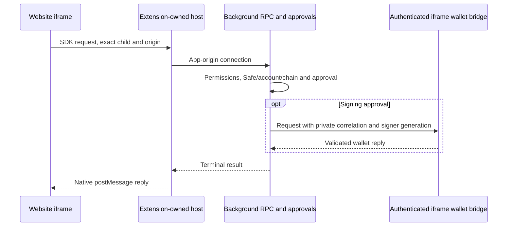
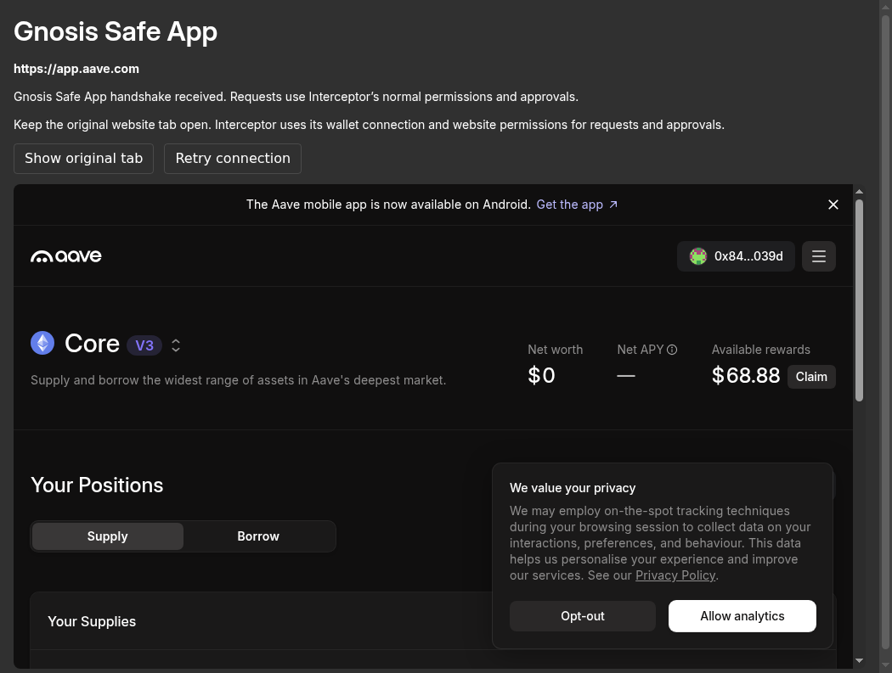
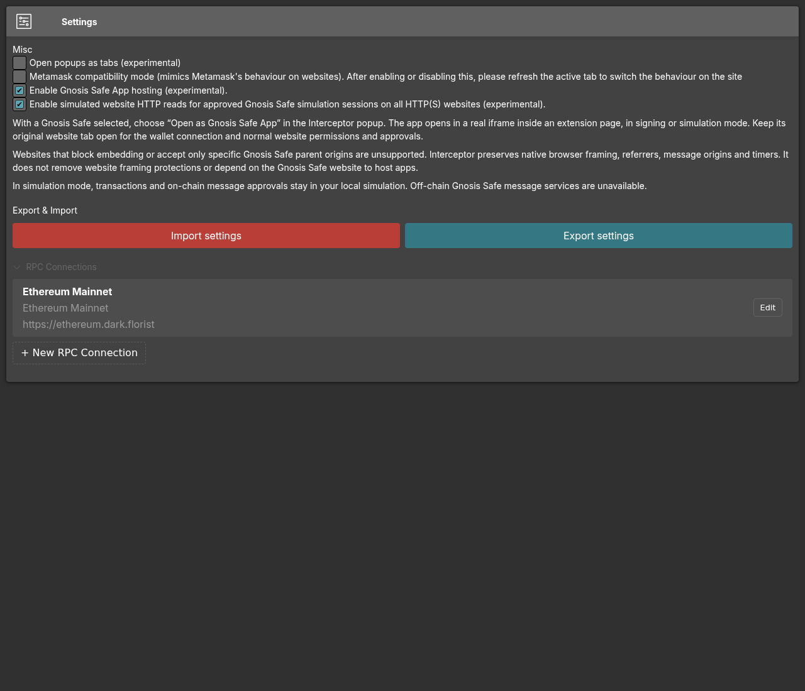

# Native Gnosis Safe Apps host

- With a Gnosis Safe selected, choose **Open as Gnosis Safe App** in the Interceptor popup. The current tab becomes an extension-owned host with a full-viewport app iframe on Chrome MV3 and Firefox MV2.
- The background owns a new connection with the app's website permission identity. No original website tab, provider or copied signer state is retained.
- SDK requests use the shared background RPC/approval pipeline. Only a browser-verified direct app frame may own the tab's wallet bridge. Signing replies are bound to the exact host request, signer generation, app origin, current permission, selected account and chain.
- Native parent, top, referrer, message origins, timers and embedding restrictions are preserved. There is no origin spoofing, header removal or dependency on app.safe.global.

## Lifecycle and limits

- The real iframe loads immediately so its wallet bridge can initialize. Public Gnosis Safe metadata is refreshed periodically with a bounded cache lifetime; both intervals and the SDK-handshake warning deadline follow the [native host timing policy](../../app/ts/utils/nativeGnosisSafeAppsHostTiming.ts). Permission, account, mode, chain and meaningful Gnosis Safe configuration changes invalidate it. Routine website titles/icons and address metadata enrichment do not interrupt an app session.
- A temporary metadata refresh failure shows an error while preserving the existing iframe and unfinished app input; recovery does not reload it or extend the metadata cache lifetime.
- The popup sends an extension-only launch command. The background validates the current website URL, enables compatibility, and replaces that tab in place. Repeating the action on its host is idempotent and preserves pending approvals.
- Wallet, mode and network changes require Retry before the existing app can make new requests with the changed selection. Permission changes remove cached metadata and are rechecked in the background. Changes during a pending operation preserve its frame for the terminal reply and block new requests until reconnection. Retry is disabled while operations remain pending. Transactions and signatures are never automatically replayed.
- Sites that block embedding, require a specific Gnosis Safe parent origin or depend on unavailable embedded login/storage behavior may be unsupported. A frame load event is not proof of connection; the host explains when no SDK handshake arrives.
- Reloading the host creates a fresh background connection and wallet bridge. Wallet extensions must support injection in embedded websites for signing; if unavailable, enable the wallet for the app or use the website directly. Connection errors expand compact controls with Retry and Open website directly actions.
- In simulation mode, transactions stay in the local stack. Off-chain Gnosis Safe message services are unavailable. HTTP read interception remains in the separate child PR; it is not part of this host architecture.

## Browser regression coverage

`bun run test:browser:native-hosting --browser=chrome` and the equivalent Firefox invocation run the same fixture. The shared `bun run test:browsers` matrix builds and tests both engines.

The native-host fixture passed on Chrome MV3 and Firefox MV2 in signing and simulation configurations:

- SDK metadata, chain and environment replies; real parent/source/origin relationships; unchanged timers and native referrer behavior.
- Origin mismatch rejection and permission revocation without reusing cached metadata.
- Same-tab replacement without an extra tab; full-viewport borderless layout, minimal controls and host reload recovery. Controller unit tests cover temporary refresh failure/recovery without losing unfinished input.
- Two separately approved simulation transactions in one stack, attributed to the app origin, with no owner-wallet broadcast. Retry and repeated popup launches preserve the original frame while each approval is pending.
- Honest unsupported state for a fixture that rejects the extension parent, and preservation of actual CSP/X-Frame-Options framing restrictions.

These controlled tests do not establish compatibility with every live website or exercise a real wallet or public-chain broadcast. Signing uses the real approval/bridge flow with a deterministic test wallet. Live-site results and the final project validation/review status are reported separately.

## UI screenshots

Captured directly from the shared local fixture in both browsers. These show the current host layout and actionable permission errors; they are not live-site claims.

| Browser | Full-screen app | Connection error |
| --- | --- | --- |
| Chrome MV3 | [Connected](screenshots/native-gnosis-safe-fullscreen-chrome.png) | [Permission denied](screenshots/native-gnosis-safe-error-chrome.png) |
| Firefox MV2 | [Connected](screenshots/native-gnosis-safe-fullscreen-firefox.png) | [Permission denied](screenshots/native-gnosis-safe-error-firefox.png) |

## Live-site observations (2026-11-25)

These historical trials preceded the same-tab/background-session change and do not validate the current wallet bridge. They used a public Gnosis Safe and a wallet double that cannot sign or broadcast. “Connected” means the app UI showed that account, not merely that an SDK query succeeded. No live-site transaction was submitted. Native browser policy can differ between engines.

| Website | Chrome simulation / signing | Firefox simulation | Firefox signing |
| --- | --- | --- | --- |
| Aave | Connected | Connected | Connected |
| CoW | Browser blocks the frame | Connected | SDK replies; UI connection unconfirmed |
| Lido | Browser blocks the frame | SDK replies; UI connection unconfirmed after normal connection UI | SDK replies; UI connection unconfirmed after normal connection UI |
| Request Finance | Browser blocks the frame | Browser blocks the frame | Browser blocks the frame |
| Uniswap | Browser blocks the frame | Browser blocks the frame | Browser blocks the frame |
| 1inch | Browser blocks the frame | Browser blocks the frame | Browser blocks the frame |

The genuine-Gnosis-Safe-parent prototype had broader compatibility; those results do not apply to the chosen extension-owned host. The implementation leaves these policies intact instead of spoofing a trusted origin or stripping headers. Lack of an SDK handshake is reported as a possible framing/origin/SDK compatibility limit, not a definitive browser-policy diagnosis.

Final Chrome evidence is under `/tmp/native-host-final-chrome-live/chrome`; the earlier run under `/tmp/native-host-live/chrome` preceded the metadata-context fixes and is not the final connection result. Other local evidence and screenshots are under `/tmp/native-host-live/firefox`. Firefox main-world observation reruns are under `/tmp/native-host-verified-live/firefox`, with the normal Lido consent interaction under `/tmp/native-host-consent-live/firefox`. Earlier Firefox isolated-world telemetry could not observe the child reliably; those empty telemetry arrays are not connection failures. The [committed live summary](native-gnosis-safe-live-results.json) records observed outcomes without claiming universal support.

## Chrome iframe RPC timeout

The earlier 1inch investigation found a separate provider defect: approved iframe account/chain RPCs waited for cosmetic website metadata, which waited for the outer tab to finish loading. Metadata now uses an immediate tab snapshot without tab-load or favicon polling, and a different frame origin cannot inherit the outer tab’s title/icon. A causal Chrome cross-process-frame probe changed from hanging to returning the expected account and chain; the shared provider-injection regression covers it in both engines. This fixes the RPC stall; it does not bypass 1inch’s native framing restriction above.

Historical Aave connection before the full-screen/background-session refactor (Chrome simulation configuration, no transaction submitted):

## Child HTTP simulation reads

The HTTP-interception child adds a separate, default-off **simulated website HTTP reads** setting. Enabling Gnosis Safe App hosting alone does not enable it. Existing backups preserve hosting and leave the new capability off; version 1.8 backups store both choices independently.

When enabled, approved Gnosis Safe simulation sessions receive supported JSON-RPC and vendor balance/status overlays on any HTTP(S) page. Each background read still checks the current account, chain and website grant. Signing, other-chain and unknown responses keep native network behavior. An explicitly disabled publication releases the native iframe's early network reads without an overlay.

The build privately composes the HTTP feature with the provider into one classic script for both browsers. The provider module has no vendor imports, and no page-global registration function can capture its internal RPC callback. This includes the feature code in the assembled provider artifact while allowing live preference changes and avoiding a public privileged registration channel.

Portfolio wire mapping delegates exact quantities, selected-chain value changes and group totals to a typed aggregation owner. Simulation logs and HTTP overlays derive native currency identity from one shared constant.

The settings scenario runs on both browsers through `bun run test:browsers`. These captures show the two independent controls; simulated website HTTP reads default to off:

| Chrome MV3 | Firefox MV2 |
| --- | --- |
|  |  |
